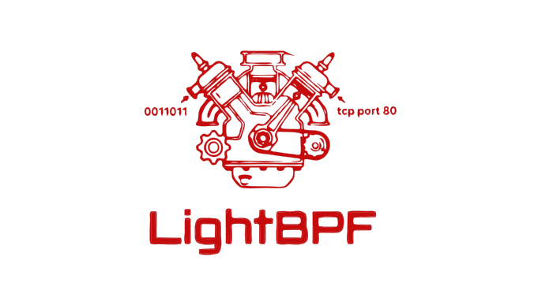

# LightBPF: Pure-Python Berkeley Packet Filter (cBPF) Engine

**LightBPF** is a standalone, pure-Python Berkeley Packet Filter engine for packet sniffing, inspection, and network security applications. It tokenizes, parses, compiles, disassembles, and emulates classic BPF (cBPF / pcap-filter) bytecode with zero native C dependencies.

```
+------------------+         +------------------+         +----------------------+
|   Filter Text    |         |   Token Stream   |         | Abstract Syntax Tree |
|  "tcp port 80"   | ----->  | [IP-PROTO, tcp], | ----->  |  KeywordFilterNode   |
|                  | (Lexer) | [KEYWORD, port]  | (Parser)|   (port=80, tcp)     |
+------------------+         +------------------+         +----------------------+
                                                                     |
                                                                     | (Compiler)
                                                                     v
                                                          +----------------------+
                                                          |  cBPF Machine Code   |
                                                          | (List[Instruction])  |
                                                          +----------------------+
                                                              /              \
                                                             /                \
                                                            v                  v
                                                  +------------------+   +-------------------+
                                                  | Linux Raw Socket |   | Pure-Python VM    |
                                                  | SO_ATTACH_FILTER |   |   (BpfEmulator)   |
                                                  +------------------+   +-------------------+
```

---

## Table of Contents

1. [Key Features](#key-features)
2. [Quick Start Guide](#quick-start-guide)
   - [Compiling a Filter](#compiling-a-filter)
   - [Offline Packet Filtering (BpfEmulator)](#offline-packet-filtering-bpfemulator)
   - [Attaching to Linux Raw Sockets](#attaching-to-linux-raw-sockets)
   - [Disassembling Bytecode](#disassembling-bytecode)
3. [Supported Filter Syntax Cheat Sheet](#supported-filter-syntax-cheat-sheet)
4. [Architecture & Pipeline](#architecture--pipeline)
   - [The Classic BPF (cBPF) Virtual Machine](#the-classic-bpf-cbpf-virtual-machine)
   - [Instruction Structure (struct bpf_insn)](#instruction-structure-struct-bpf_insn)
5. [Developer Deep-Dive: Stage 1 — Lexer (`Lexer.py`)](#developer-deep-dive-stage-1--lexer-lexerpy)
   - [Tokenizer Mechanics](#tokenizer-mechanics)
   - [Token Reference Table](#token-reference-table)
6. [Developer Deep-Dive: Stage 2 — Parser (`Parser.py`)](#developer-deep-dive-stage-2--parser-parserpy)
   - [Grammar & Operator Precedence](#grammar--operator-precedence)
   - [Abstract Syntax Tree (AST) Reference](#abstract-syntax-tree-ast-reference)
7. [Developer Deep-Dive: Stage 3 — Compiler (`Compiler.py`)](#developer-deep-dive-stage-3--compiler-compilerpy)
   - [Short-Circuit Boolean Control Flow](#short-circuit-boolean-control-flow)
   - [Relative Jump Resolution & Jump Threading](#relative-jump-resolution--jump-threading)
   - [Register Spilling via Scratch Memory (M[0..15])](#register-spilling-via-scratch-memory-m015)
   - [Dynamic IPv4 IHL Tracking (BPF_MSH)](#dynamic-ipv4-ihl-tracking-bpf_msh)
   - [VLAN 802.1Q Handling](#vlan-8021q-handling)
   - [Bitmask Optimization (BPF_JSET)](#bitmask-optimization-bpf_jset)
8. [Worked Examples & Disassembly Traces](#worked-examples--disassembly-traces)
   - [Example 1: `tcp and port 80`](#example-1-tcp-and-port-80)
   - [Example 2: `tcp[13] & 2 != 0` (TCP SYN)](#example-2-tcp13--2--0-tcp-syn)
   - [Example 3: `host 192.168.1.1`](#example-3-host-19216811)
   - [Example 4: `vlan 100`](#example-4-vlan-100)
   - [Example 5: `(ip[0] & 0xf) * 4 > 20`](#example-5-ip0--0xf--4--20)
9. [Verification & Testing](#verification--testing)
10. [Opcode & Constant Reference](#opcode--constant-reference)

---

## Key Features

- **100% Pure Python**: Runs everywhere without needing `libpcap`, `gcc`, or external tools installed.
- **Full cBPF Instruction Coverage**: Complete support for classes, addressing modes, arithmetic/bitwise operations, and jump branches.
- **Dual-Stack Networking**: Handles both IPv4 (with dynamic IHL header offsets) and IPv6 (multi-word 128-bit checks).
- **Rich Protocol & Filter Support**: Protocols (`tcp`, `udp`, `icmp`, `arp`, `vlan`, `mpls`), network filters (`host`, `net`, `port`, `portrange`), byte access (`tcp[13]`, `ip[2:2]`), and pseudo-fields (`tcpflags`, `icmptype`).
- **Scratch Memory Spilling**: Uses cBPF registers `M[0..15]` to compile nested mathematical expressions on both sides of comparisons.
- **Peephole Jump Optimization**: Automatically flattens jump chains via jump threading.
- **Integrated VM Emulator**: Execute BPF filters on raw byte packets in unit tests or user-space applications without root privileges.
- **Standard Serialization**: Export to Linux kernel `struct sock_fprog` or 8-byte raw machine instruction streams.

---

## Installation

### From our PyPi image (wheel)
```bash
pip install lightbpf
```

### From our github (source)

```bash
git clone https://github.com/Light-Projects/LightBPF
```

---

## Quick Start Guide

### Compiling a Filter

```python
from LightBPF.CompilerSet.Compiler import BpfCompiler

# Compile a classic filter string directly into cBPF bytecode
instructions = BpfCompiler.compile_str("tcp port 80 and src host 192.168.1.10")

print(f"Compiled into {len(instructions)} BPF instructions:")
for i, insn in enumerate(instructions):
    print(f"  [{i:02d}] {insn}")
```

### Offline Packet Filtering (`BpfEmulator`)

You can execute filters directly on raw bytes in Python:

```python
from LightBPF.CompilerSet.Compiler import BpfCompiler
from LightBPF.CompilerSet.Emulator import BpfEmulator

filter_code = BpfCompiler.compile_str("tcp[tcpflags] & tcp-syn != 0")

raw_packet = b"..."  # raw Ethernet frame bytes

# Returns captured length (> 0) if matched, 0 if rejected
match_len = BpfEmulator.execute(filter_code, raw_packet)

if match_len > 0:
    print(f"Matched! Captured {match_len} bytes.")
else:
    print("Rejected.")
```

### Attaching to Linux Raw Sockets

Attach compiled filters straight to a Linux AF_PACKET raw socket with `SO_ATTACH_FILTER`:

```python
import socket
from LightBPF.CompilerSet.Compiler import BpfCompiler
from LightBPF.CompilerSet.Fprog import to_fprog

# 1. Open raw socket
sock = socket.socket(socket.AF_PACKET, socket.SOCK_RAW, socket.htons(0x0003))
sock.bind(("eth0", 0))

# 2. Compile and package into ctypes sock_fprog
instructions = BpfCompiler.compile_str("tcp and port 443")
fprog = to_fprog(instructions)

# 3. Attach in kernel space
SO_ATTACH_FILTER = 26
sock.setsockopt(socket.SOL_SOCKET, SO_ATTACH_FILTER, fprog)
```

### Disassembling Bytecode

Print human-readable cBPF assembly formatted like `tcpdump -d`:

```python
from LightBPF.CompilerSet.Compiler import BpfCompiler
from LightBPF.CompilerSet.Disassembler import disassemble

insns = BpfCompiler.compile_str("ip and (port 80 or port 443)")
print(disassemble(insns))
```

---

## Supported Filter Syntax Cheat Sheet

| Category | Filter Examples | Description |
|---|---|---|
| **Protocols** | `ip`, `ip6`, `tcp`, `udp`, `icmp`, `arp`, `vlan`, `mpls`, `ether` | Standalone protocol verification |
| **Hosts** | `host 192.168.1.1`<br>`src host 10.0.0.1`<br>`dst host fe80::1`<br>`ether host aa:bb:cc:dd:ee:ff` | Match IPv4, IPv6 (4 words), or MAC address |
| **Networks** | `net 10.0.0.0/8`<br>`src net 192.168.1.0/24`<br>`net 10.0.0.0 mask 255.0.0.0`<br>`ip6 net 2001:db8::/32` | CIDR and netmask matching |
| **Ports** | `port 80`<br>`tcp dst port 443`<br>`udp port 53`<br>`src port http`<br>`portrange 1000-2000` | Port, port range, and service name resolution |
| **Byte Access** | `tcp[13] & 2 != 0`<br>`ip[2:2] > 500`<br>`ether[12:2] == 0x0800`<br>`tcp[tcpflags] & tcp-syn != 0` | Arbitrary byte/half/word extraction |
| **Header Length** | `(ip[0] & 0xf) * 4 > 20` | Dynamic IPv4 IHL calculations |
| **Packet Size** | `len > 100`, `less 64`, `greater 1500` | Frame size checks via `BPF_LEN` |
| **Broadcast / Multicast** | `broadcast`<br>`multicast` | Ethernet broadcast and multicast bit checks |
| **VLAN / MPLS** | `vlan`, `vlan 100`<br>`mpls`, `mpls 500` | Tag presence and ID/label extraction |
| **Protocol Numbers** | `ip proto 6`, `ip proto tcp`, `ether proto 0x0800` | Layer 3/4 protocol inspection |
| **Boolean Logic** | `tcp and port 80`<br>`tcp or udp`<br>`not port 22`<br>`(tcp or udp) and not dst port 53` | Short-circuit boolean combinations |

---

## Architecture & Pipeline

### The Classic BPF (cBPF) Virtual Machine

cBPF is a 32-bit register machine designed specifically for in-kernel packet filtering:

```
+----------------------------------------------------------------+
|                   cBPF Virtual Machine Registers               |
|                                                                |
|  [ Register A ] (32-bit Accumulator)                           |
|    - Holds results of packet loads, arithmetic, and tests      |
|                                                                |
|  [ Register X ] (32-bit Index Register)                        |
|    - Used for indexed packet addressing: packet[X + k]         |
|    - Second operand for ALU operations                         |
|                                                                |
|  [ Memory M[0..15] ] (16 Scratch Words)                        |
|    - Register spill space for complex nested expressions       |
|                                                                |
|  [ Program Counter (PC) ]                                      |
+----------------------------------------------------------------+
```

### Instruction Structure (`struct bpf_insn`)

Every instruction is exactly 8 bytes:

```
 0                   1                   2                   3
 0 1 2 3 4 5 6 7 8 9 0 1 2 3 4 5 6 7 8 9 0 1 2 3 4 5 6 7 8 9 0 1
+-+-+-+-+-+-+-+-+-+-+-+-+-+-+-+-+-+-+-+-+-+-+-+-+-+-+-+-+-+-+-+-+
|          code (16)            |    jt (8)     |    jf (8)     |
+-+-+-+-+-+-+-+-+-+-+-+-+-+-+-+-+-+-+-+-+-+-+-+-+-+-+-+-+-+-+-+-+
|                            k (32)                             |
+-+-+-+-+-+-+-+-+-+-+-+-+-+-+-+-+-+-+-+-+-+-+-+-+-+-+-+-+-+-+-+-+
```

- **`code`** (16 bits): Opcode encoding class, size modifier, and addressing mode/ALU operator.
- **`jt`** (8 bits): Jump-true relative offset (number of instructions to skip forward if comparison succeeds).
- **`jf`** (8 bits): Jump-false relative offset (number of instructions to skip forward if comparison fails).
- **`k`** (32 bits): Multi-purpose value (packet offset, immediate constant, or scratch index).

---

## Developer Deep-Dive: Stage 1 — Lexer (`Lexer.py`)

The `BpfLexer` turns a raw filter string into a list of typed `Token` tuples: `(type, value)`.

### Tokenizer Mechanics
- **Regex Ordering**: The tokenizer runs a single compiled regex with named groups. Specific tokens (such as MAC addresses and IPv6 with colons) take precedence over general words and symbols.
- **Normalization**: Operators like `&&`, `||`, and `!` are normalized directly into `and`, `or`, and `not`.
- **Named Constants**: TCP flags (`tcp-syn`, `tcp-ack`, `tcp-fin`) and ICMP types (`icmp-echo`, `icmp-echoreply`) are resolved directly into integer `NUMBER` tokens at lex time.

### Token Reference Table

| Token Type | Examples | Produced From |
|---|---|---|
| `NUMBER` | `'80'`, `'2048'`, `'2'` | Integer digits, hex (`0x0800`), named constants (`tcp-syn` $\rightarrow$ `2`) |
| `IPV4` | `'192.168.1.1'` | Standard dotted-quad IPv4 |
| `IPV4_CIDR` | `'10.0.0.0/8'` | Dotted-quad with prefix |
| `IPV6` | `'fe80::1'` | Colon-delimited hex address |
| `IPV6_CIDR` | `'2001:db8::/32'` | Colon-hex with prefix |
| `MAC` | `'aa:bb:cc:dd:ee:ff'` | 6 hex pairs with colons |
| `RANGE` | `'1000-2000'` | Port range syntax |
| `IP-PROTOCOL` | `'tcp'`, `'udp'`, `'icmp'`, `'gre'` | IP protocol names |
| `ETHERTYPE` | `'ip'`, `'ip6'`, `'arp'`, `'vlan'` | Link-layer protocol names |
| `KEYWORD` | `'host'`, `'port'`, `'net'`, `'src'`, `'dst'` | Filter keywords |
| `FIELD` | `'tcpflags'`, `'icmptype'` | Named protocol fields |
| `REL_OP` | `'=='`, `'!='`, `'>'`, `'>='`, `'<'`, `'<='` | Comparison operators |
| `MATH_OP` | `'+'`, `'-'`, `'*'`, `'/'`, `'%'`, `'&'`, `'\|'`, `'^'`, `'<<'`, `'>>'` | Arithmetic and bitwise operators |

---

## Developer Deep-Dive: Stage 2 — Parser (`Parser.py`)

The `BpfParser` implements a **recursive descent** parser that turns the token stream into an Abstract Syntax Tree (AST).

### Grammar & Operator Precedence

Precedence is enforced through tiered grammar methods (lowest to highest):

```
expr_or        := expr_and  ( 'or'  expr_and )*
expr_and       := expr_not  ( 'and' expr_not )*
expr_not       := 'not' expr_not | expr_primary
expr_primary   := '(' expr_or ')' | qualifier_rule | expr_relation
expr_relation  := expr_bitor ( REL_OP expr_bitor )?
expr_bitor     := expr_bitxor ( '|'  expr_bitxor )*
expr_bitxor    := expr_bitand ( '^'  expr_bitand )*
expr_bitand    := expr_shift  ( '&'  expr_shift )*
expr_shift     := expr_add    ( ('<<'|'>>') expr_add )*
expr_add       := expr_mult   ( ('+'|'-') expr_mult )*
expr_mult      := expr_atom   ( ('*'|'/'|'%') expr_atom )*
```

### Abstract Syntax Tree (AST) Reference

```python
# Boolean Operations
BinaryOpNode(left: ASTNode, op: str, right: ASTNode)
UnaryOpNode(op: str, expr: ASTNode)

# Protocols & Qualifiers
ProtocolNode(name: str, proto_num: Optional[int] = None)
KeywordFilterNode(
    keyword: str,
    value: Any = None,
    direction: Optional[str] = None,   # 'src' | 'dst' | 'src or dst' | 'src and dst'
    protocol: Optional[str] = None,    # 'tcp' | 'ip6' | 'ether' ...
    value_type: Optional[str] = None,  # 'ipv4' | 'ipv6' | 'mac' | 'cidr4' | 'cidr6' | 'number' | 'range' | 'name'
    mask: Optional[str] = None         # for 'net X mask Y'
)

# Packet Access & Values
ByteAccessNode(protocol: str, offset: ASTNode, size: int = 1)
LengthNode()                           # 'len' operand
NumberNode(value: int)
LiteralNode(value: str, kind: str)
FieldNode(name: str)                   # 'tcpflags', 'icmptype'
```

---

## Developer Deep-Dive: Stage 3 — Compiler (`Compiler.py`)

The `BpfCompiler` walks the AST and emits classic BPF instructions.

### Short-Circuit Boolean Control Flow

All boolean sub-expressions compile with two symbolic jump targets: `true_target` and `false_target`.

- **`A and B`**: `A` compiles with `true_target = label_B` and `false_target = overall_false`. If `A` passes, it falls into `B`. If `A` fails, it immediately jumps to `overall_false`.
- **`A or B`**: `A` compiles with `true_target = overall_true` and `false_target = label_B`. If `A` passes, it immediately short-circuits to `overall_true`.
- **`not A`**: Swaps the true and false branch targets of `A`.

### Relative Jump Resolution & Jump Threading

In cBPF, relative jump offsets specify how many instructions to skip **past the next instruction**:

Before computing final numeric offsets, the compiler executes **Jump Threading (Peephole Optimization)**:
If a jump target points to an unconditional jump (`ja target_2`), the compiler rewrites the jump to target `target_2` directly, eliminating wasted jump hops.

### Register Spilling via Scratch Memory (`M[0..15]`)

cBPF only has two general registers: Accumulator `A` and Index `X`. When compiling complex binary operations where both the left and right operands are expressions (e.g. `(ip[0] & 0xf) * 4 == (tcp[12] >> 4) * 4`):

1. Right operand compiles into Register `A`.
2. Emits `st M[scratch]` to store the right operand in scratch memory.
3. Left operand compiles into Register `A`.
4. Emits `ldx M[scratch]` to load the right operand into Register `X`.
5. Emits the ALU or comparison operation using Register `X` (`BPF_X`).

### Dynamic IPv4 IHL Tracking (`BPF_MSH`)

IPv4 headers can vary in length between 20 and 60 bytes due to optional fields. To locate transport-layer headers (TCP/UDP) reliably without hardcoding an offset:

```python
self._emit(Instruction(BPF_LDX | BPF_B | BPF_MSH, 0, 0, 14))
```

The `BPF_MSH` opcode computes:
storing the exact byte length of the IPv4 header into Register `X`.
Subsequent transport-layer loads use indexed addressing (`BPF_IND`):
- Source Port: `ldh [x + 14]`
- Destination Port: `ldh [x + 16]`

### VLAN 802.1Q Handling

An 802.1Q tagged frame has the following layout:

```
Byte 12..13: TPID (0x8100)
Byte 14..15: TCI (Bits 15-13: Priority, Bit 12: DEI, Bits 11-0: 12-bit VLAN ID)
```

For `vlan 100`:
1. `ldh [12]` $\rightarrow$ Verify EtherType is `0x8100`.
2. `ldh [14]` $\rightarrow$ Load 16-bit TCI.
3. `and #0x0fff` $\rightarrow$ Mask out Priority and DEI to isolate the 12-bit VLAN ID.
4. `jeq #100` $\rightarrow$ Match target VLAN ID.

### Bitmask Optimization (`BPF_JSET`)

When testing specific bitflags (e.g. `tcp[13] & 2 != 0` or `tcp[tcpflags] & tcp-syn != 0`), the compiler optimizes this pattern into a single `BPF_JSET` jump instruction:

```
ldb [x + 27]             ; Load TCP flags byte
jset #2 jt ACCEPT jf REJECT
```

This tests `(A & 2) != 0` in a single hardware cycle.

---

## Worked Examples & Disassembly Traces

### Example 1: `tcp and port 80`

```python
insns = BpfCompiler.compile_str("tcp and port 80")
print(disassemble(insns))
```

```
(000) ldh [12]                  ; Load EtherType
(001) jeq #0x800 jt 2 jf 9      ; Is IPv4?
(002) ldb [23]                  ; Load IP Protocol byte
(003) jeq #6 jt 4 jf 9          ; Is TCP (6)?
(004) ldxb 4*([14]&0xf)         ; Load IPv4 Header Length into X
(005) ldh [x + 14]              ; Load TCP Source Port
(006) jeq #80 jt 8 jf 7         ; Is src port 80? (If yes, accept)
(007) ldh [x + 16]              ; Load TCP Destination Port
(008) jeq #80 jt 10 jf 9        ; Is dst port 80? (If yes, accept; else reject)
(009) ret #0                    ; REJECT (Return 0)
(010) ret #262144               ; ACCEPT (Return max buffer)
```

---

### Example 2: `tcp[13] & 2 != 0` (TCP SYN)

```python
insns = BpfCompiler.compile_str("tcp[13] & 2 != 0")
print(disassemble(insns))
```

```
(000) ldxb 4*([14]&0xf)         ; X = IPv4 IHL
(001) ldb [x + 27]              ; Load byte 13 of TCP (14 + 13 = 27)
(002) jset #2 jt 4 jf 3         ; Test bit 2 (SYN flag)
(003) ret #0                    ; REJECT
(004) ret #262144               ; ACCEPT
```

---

### Example 3: `host 192.168.1.1`

```python
insns = BpfCompiler.compile_str("host 192.168.1.1")
print(disassemble(insns))
```

```
(000) ldh [12]                  ; Load EtherType
(001) jeq #0x800 jt 2 jf 5      ; Is IPv4?
(002) ld [26]                   ; Load Source IP
(003) jeq #0xc0a80101 jt 6 jf 4 ; Matches 192.168.1.1?
(004) ld [30]                   ; Load Destination IP
(005) jeq #0xc0a80101 jt 6 jf 5 ; Matches 192.168.1.1?
(006) ret #0                    ; REJECT
(007) ret #262144               ; ACCEPT
```

---

### Example 4: `vlan 100`

```python
insns = BpfCompiler.compile_str("vlan 100")
print(disassemble(insns))
```

```
(000) ldh [12]                  ; Load EtherType
(001) jeq #0x8100 jt 2 jf 5     ; Is 802.1Q VLAN?
(002) ldh [14]                  ; Load TCI (Tag Control Information)
(003) and #0xfff                ; Mask out Priority & DEI to get 12-bit VID
(004) jeq #100 jt 6 jf 5        ; Is VID == 100?
(005) ret #0                    ; REJECT
(006) ret #262144               ; ACCEPT
```

---

### Example 5: `(ip[0] & 0xf) * 4 > 20`

Checks if the IPv4 packet contains IP Options (IHL > 20 bytes):

```python
insns = BpfCompiler.compile_str("(ip[0] & 0xf) * 4 > 20")
print(disassemble(insns))
```

```
(000) ldb [14]                  ; Load byte 0 of IP header
(001) and #15                   ; Mask lower 4 bits (IHL)
(002) mul #4                    ; Multiply by 4 (header length in bytes)
(003) jgt #20 jt 5 jf 4         ; Is header length > 20?
(004) ret #0                    ; REJECT
(005) ret #262144               ; ACCEPT
```

---

## Opcode & Constant Reference

### Instruction Classes (`code & 0x07`)
| Constant | Hex | Description |
|---|---|---|
| `BPF_LD` | `0x00` | Load into Register A |
| `BPF_LDX` | `0x01` | Load into Register X |
| `BPF_ST` | `0x02` | Store Register A into `M[k]` |
| `BPF_STX` | `0x03` | Store Register X into `M[k]` |
| `BPF_ALU` | `0x04` | Arithmetic or Bitwise operation on A |
| `BPF_JMP` | `0x05` | Jump operation |
| `BPF_RET` | `0x06` | Return from filter |
| `BPF_MISC` | `0x07` | Register transfer (`tax`, `txa`) |

### Addressing Modes (`code & 0xe0`)
| Constant | Hex | Description |
|---|---|---|
| `BPF_IMM` | `0x00` | Immediate constant `k` |
| `BPF_ABS` | `0x20` | Absolute packet byte offset `packet[k]` |
| `BPF_IND` | `0x40` | Indexed packet offset `packet[X + k]` |
| `BPF_MEM` | `0x60` | Scratch memory word `M[k]` |
| `BPF_LEN` | `0x80` | Packet length |
| `BPF_MSH` | `0xa0` | Load $4 \times (\text{packet}[k] \ \& \ \text{0x0F})$ into X |

### ALU Operations (`code & 0xf0`)
| Constant | Hex | Operation |
|---|---|---|
| `BPF_ADD` | `0x00` | `A = A + operand` |
| `BPF_SUB` | `0x10` | `A = A - operand` |
| `BPF_MUL` | `0x20` | `A = A * operand` |
| `BPF_DIV` | `0x30` | `A = A / operand` |
| `BPF_OR` | `0x40` | `A = A \| operand` |
| `BPF_AND` | `0x50` | `A = A & operand` |
| `BPF_LSH` | `0x60` | `A = A << operand` |
| `BPF_RSH` | `0x70` | `A = A >> operand` |
| `BPF_NEG` | `0x80` | `A = -A` |
| `BPF_MOD` | `0x90` | `A = A % operand` |
| `BPF_XOR` | `0xa0` | `A = A ^ operand` |

### Jump Operations (`code & 0xf0`)
| Constant | Hex | Jump Condition |
|---|---|---|
| `BPF_JA` | `0x00` | Unconditional jump |
| `BPF_JEQ` | `0x10` | Jump if `A == operand` |
| `BPF_JGT` | `0x20` | Jump if `A > operand` |
| `BPF_JGE` | `0x30` | Jump if `A >= operand` |
| `BPF_JSET` | `0x40` | Jump if `(A & operand) != 0` |

---

## v1.1 Compiler Fixes

This release combines correctness fixes, a full package reorganisation, and two new optimization passes. The Lexer and Parser are **byte-for-byte unchanged**; every change lives inside `LightBPF/Compiler/` or its sibling modules.

The single largest behavioural change is the completion of _false-target threading_: every byte-access expression (`tcp[13]`, `ip[0]`, `icmp[icmptype]`, …) now routes protocol-mismatch through the enclosing boolean's reject target, instead of fabricating a `0` value that only happened to be correct for bitmask tests.

**Verification target:** the following filters compile to bytecode that matches `tcpdump -d` semantics and round-trip correctly through `BpfEmulator` on real IPv4, IPv6, ARP, VLAN, and MPLS frames: `tcp and port 80`, `tcp[13] & 2 != 0`, `host fe80::1`, `udp port 53`, `net 10.0.0.0`, `ip[2:2] > 500`, `(tcp or udp) and not dst port 53`, `ip[0] != 5` (ARP frame → reject).

---

### Package Split

The single `Compiler.py` file is now nine modules organised by concern. The public import path is **unchanged** — existing callers continue to work:

```python
from LightPacket.LightBPF.CompilerSet.Compiler import BpfCompiler
```

```
LightBPF/
├── Lexer.py                  # unchanged
├── Parser.py                 # unchanged
├── README.md                 # package documentation
├── Ethertype.py              # ethertypes dict
└── CompilerSet/              # new package
    ├── Opcode.py             # BPF_* constants + bitfield accessors
    ├── Instruction.py        # code/jt/jf/k dataclass + serialisation
    ├── Fprog.py              # ctypes sock_fprog / bpf_insn
    ├── Peephole.py           # instruction-level optimizer (runs after backpatch)
    ├── Compiler.py           # BpfCompiler main class
    ├── Disassembler.py       # disassemble(), c_str_style()
    └── Emulator.py           # BpfEmulator VM
    
```


---

### Summary Table

| # | Issue | Severity | Category |
|---|---|---|---|
| 1 | `to_fprog()` returned a dangling ctypes pointer | **Critical** | Memory safety |
| 2 | `Instruction.__repr__` raised `ValueError` at runtime | **Critical** | Runtime error |
| 3 | `net` classful mask computed as /32 instead of /8, /16, /24 | **Critical** | Semantics |
| 4 | Byte-access guard now rejects via `false_target`, not `ld #0` | **Critical** | Semantics |
| 5 | Transport filters (`port`, `portrange`) were IPv4-only | **Critical** | Semantics |
| 6 | `inbound`/`outbound` silently matched every packet | **Critical** | Semantics |
| 7 | `gateway` compiled with wrong (opposite) semantics | **Critical** | Semantics |
| 8 | Dual-stack `_compile_protocol` never jumped to `true_target` | **Critical** | Semantics |
| 9 | `disassemble()` `ret a` branch was unreachable | **Critical** | Correctness |
| 10 | `src and dst` direction fell through to `src or dst` logic | **High** | Logic |
| 11 | Standalone pseudo-fields (`tcpflags`, etc.) compiled to nonsense | **High** | Logic |
| 12 | Division / modulo by constant zero passed the compiler | **High** | Verifier |
| 13 | Conditional-jump `jt`/`jf` offsets could overflow 8 bits silently | **High** | Correctness |
| 14 | Division-by-zero guard in `_compile_comparison` was dead code | **High** | Verifier |
| 15 | Non-first IPv4 fragment not rejected on transport-port path | **High** | Semantics |
| 16 | `false_target` threading completed on all call sites | **High** | Correctness |
| 17 | `vlan` filter only matched EtherType `0x8100`, missed QinQ `0x88a8` | **Medium** | Coverage |
| 18 | `icmp` and `icmp6` cross-matched IP versions | **Medium** | Semantics |
| 19 | Proto-name resolution in `_compile_proto_filter` was fragile | **Medium** | Robustness |
| 20 | `c_str_style()` crashed with `TypeError` on unresolved label strings | **Medium** | Robustness |
| 21 | `portrange` lo/hi values not coerced to `int` | **Medium** | Robustness |
| 22 | Hostname resolution mutated the AST node in place | **Low** | Purity |
| 23 | `LiteralNode` silently loaded `0` for unsupported kinds | **Low** | Purity |
| 24 | Stale commented-out instructions in `_setup_transport_layer` | **Low** | Code quality |
| 25 | Package split into 9 modules + two optimization passes added | — | Structure |

---

### Critical Bugs

#### Fix 1 — `to_fprog()` dangling ctypes pointer

The `bpf_insn` ctypes array was a local variable that was garbage-collected as soon as `to_fprog()` returned. The `sock_fprog.filter` pointer then pointed at freed memory. Any subsequent `SO_ATTACH_FILTER` call silently attached garbage or crashed.

**Before:**
```python
fprog = sock_fprog(len(instructions),
                   ctypes.cast(insn_arr, ctypes.POINTER(bpf_insn)))
return fprog  # insn_arr goes out of scope here
```

**After:**
```python
fprog._insn_arr = insn_arr  # keep the backing array alive
return fprog
```

---

#### Fix 2 — `Instruction.__repr__` raised `ValueError`

A conditional expression was embedded inside an f-string format spec (`:x if isinstance(...) else ...`), which Python's format-string grammar does not support. Every call to `repr()`, `print()`, or `disassemble()` raised an exception.

**Before:**
```python
f"k=0x{self.k:x if isinstance(self.k, int) else self.k}"
```

**After:**
```python
k_repr = f"0x{self.k:x}" if isinstance(self.k, int) else str(self.k)
f"k={k_repr}"
```

---

#### Fix 3 — Classful `net` mask was /32 for a dotted-quad

For a four-part address like `net 10.0.0.0`, the original code computed `prefix = len(parts) * 8 = 32`, producing a /32 host-route instead of the classful /8 tcpdump uses.

**Before:**
```python
prefix = len(parts) * 8  # net 10.0.0.0 → /32
```

**After:**
```python
# Class A / B / C inference (matches tcpdump behaviour)
prefix = 8 if first < 128 else 16 if first < 192 else 24 if first < 224 else 32
```

---

#### Fix 4 — Byte-access protocol guard routed mismatch to `ld #0`, not `false_target`

Two related bugs. First, `tcp[13]` and `ip[0]` compiled to bare `ldb`/`ldh` with no EtherType or IP-protocol check, so they could read bytes out of an ARP or IPv6 frame. The initial fix for that emitted `ld #0` on mismatch — which is _the wrong answer_ in every comparison except a bitmask test. `ip[0] != 5` on an ARP frame would have been accepted, because `0 != 5` is true.

The correct fix is to route the mismatch to the enclosing boolean's `false_target`, exactly like every other predicate failure. This required threading `false_target` through every value-compilation call site.

**Before (intermediate fix):**
```
(001) jeq #0x800 jt 2 jf 3   ; mismatch → ld #0 (wrong)
(002) ldb [14]
(003) div #2                  ; arithmetic runs on EtherType value
```

**After:**
```
(001) jeq #0x800 jt 2 jf 6   ; mismatch → REJECT
(002) ldb [14]
(003) div #2
```

An ARP frame has EtherType `0x0806`. The old path made `ip[0] != 5` accept it (`0 != 5`). The threaded false target rejects non-IP frames before any arithmetic runs.

---

#### Fix 5 — Transport filters were IPv4-only

`_setup_transport_layer()` rejected anything that was not EtherType `0x0800`, so `tcp port 80`, `udp port 53`, `portrange 1000-2000`, etc. could never match an IPv6 packet. The rewrite fans out to both an IPv4 path (using `BPF_MSH` for dynamic IHL) and an IPv6 path (fixed `X = 40`).

---

#### Fix 6 — `inbound`/`outbound` silently matched everything

These direction qualifiers cannot be expressed in pure classic BPF without socket metadata. The original compiled them to an unconditional jump to `ACCEPT`. The fix raises `NotImplementedError` with a clear message.

---

#### Fix 7 — `gateway` had inverted semantics

`gateway host` in libpcap means "Ethernet address matches the host but IP address does not". The original code fell through to `_compile_host_filter`, matching on IP address — the opposite. The fix raises `NotImplementedError`.

---

#### Fix 8 — Dual-stack `_compile_protocol` never jumped to `true_target`

After the IPv6 fragment-header traversal in `_compile_protocol`, the `ip6_ok` label was followed by a leftover `BPF_LDX | BPF_IMM` (setting X for transport callers) and the method returned — with no jump to `true_target`. A standalone filter like `proto sctp` on an IPv6 packet would correctly identify the protocol byte and then fall off the end without accepting the packet.

**Before:**
```python
self._emit_label(ip6_ok)
self._emit(Instruction(BPF_LDX | BPF_IMM, 0, 0, 40))
# ← method returns; no jump to true_target
```

**After:**
```python
self._emit_label(ip6_ok)
self._emit(Instruction(BPF_JMP | BPF_JA, 0, 0, true_target))
```

The transport setup path (which genuinely needs `X = 40`) is now its own shared helper.

---

#### Fix 9 — `disassemble()` `ret a` branch was unreachable

The `BPF_RET` branch used the condition `mode == BPF_K or not BPF_A`. Since `BPF_A = 0x10`, `not BPF_A` is always `False` — the whole condition collapses to `mode == BPF_K`, making the `ret a` branch permanently dead. The same bug existed in the emulator's `BPF_RET` handling.

**Before:**
```python
text = f"ret #{hex(int(insn.k))}" if mode == BPF_K or not BPF_A else "ret a"
```

**After:**
```python
text = "ret a" if mode == BPF_A else f"ret #{hex(int(insn.k))}"
```

---

### Correctness & Completeness Gaps

#### Fix 10 — `src and dst` fell through to `src or dst`

Four filter functions (`_compile_host_filter` IPv4 and MAC branches, `_compile_net_filter` IPv6, `_compile_portrange_filter`) handled only `src`, `dst`, and a default `else` clause. The `src and dst` direction landed in the `else` branch with OR semantics. Each now has an explicit `elif direction == "src and dst"` that requires both checks to pass.

---

#### Fix 11 — Standalone pseudo-fields compiled to nonsense

`FieldNode` (`tcpflags`, `icmptype`, etc.) was treated as a numeric value equal to its byte offset. So `tcpflags == 2` compiled to "compare 13 to 2", which is never true. The fix raises `NotImplementedError` in both `_compile_value` and `_compile_bool`, directing users to the correct `tcp[tcpflags]` syntax.

---

#### Fix 12 — Division / modulo by constant zero

`BPF_DIV` and `BPF_MOD` with `k == 0` are rejected by the Linux kernel BPF verifier. The compiler emitted them without complaint. The fix raises `ValueError` at compile time in `_compile_arithmetic` when a constant zero divisor is detected.

---

#### Fix 13 — Conditional-jump offsets could overflow 8 bits silently

`jt` and `jf` are 8-bit fields in `struct bpf_insn`. A large boolean chain could produce offsets above 255. `struct.pack("B", ...)` silently truncated those, corrupting every following jump. The fix detects values outside `[0, 255]` after backpatching and raises `ValueError`.

---

#### Fix 14 — Division-by-zero guard in `_compile_comparison` was dead code

The guard condition included `and not node.op`. Since `node.op` is always a non-empty string, `not node.op` is always `False`, making the guard permanently inactive. The fix removes the bogus clause and restructures the check to inspect `node.left` for a divide/modulo sub-expression with a constant-zero right operand.

**Before:**
```python
if isinstance(node.right, NumberNode) and node.right.value == 0 \
        and isinstance(node.left, BinaryOpNode) and node.left.op in ("/", "%") \
        and not node.op:   # ← always False
```

**After:**
```python
if (isinstance(node.left, BinaryOpNode) and node.left.op in ("/", "%")
        and isinstance(node.left.right, NumberNode)
        and node.left.right.value == 0):
```

---

#### Fix 15 — Non-first IPv4 fragment not rejected on transport-port path

On the `tcp port 80` / `udp port 53` path, a non-first IPv4 fragment does not carry the transport header — the port bytes would be read from fragment payload. The setup now checks the fragment-offset field at byte 20 and jumps to the enclosing reject if any offset bits are set.

**Before:**
```
(XXX) ldxb 4*([14]&0xf)
(XXX) ldh  [x + 14]       ; reads fragment payload on non-first fragment
(XXX) jeq  #80 ...
```

**After:**
```
(XXX) ldh  [20]            ; flags + fragment offset
(XXX) jset #0x1fff ...     ; non-zero offset → reject
(XXX) ldxb 4*([14]&0xf)
(XXX) ldh  [x + 14]
(XXX) jeq  #80 ...
```

---

#### Fix 16 — `false_target` threading completed on all call sites

`_compile_comparison` and `_compile_bitwise_bool` called `_compile_value(node.left)` without passing `false_target` on the constant-RHS fast path. Any expression of the form `ip[N] op constant` or `(ip[N] & mask) op constant` would hit the `ByteAccessNode` guard inside `_compile_value` and raise `NotImplementedError("Byte access must appear inside a boolean context")` — even though it is a valid boolean context. The fix passes `false_target` at every call site.

**Before:**
```python
# In _compile_comparison, constant-RHS fast path:
self._compile_value(node.left)        # ← no false_target
# In _compile_bitwise_bool:
self._compile_value(node.left)        # ← no false_target
```

**After:**
```python
self._compile_value(node.left, false_target)
```

---

### Safety & Robustness

#### Fix 17 — `vlan` filter missed QinQ EtherType `0x88a8`

The VLAN filter only accepted the standard 802.1Q EtherType `0x8100` and silently rejected 802.1ad QinQ frames. The fix adds a second `JEQ` check for `0x88a8`.

---

#### Fix 18 — `icmp` and `icmp6` cross-matched IP versions

The generic dual-stack protocol path allowed `icmp` (proto 1) to match IPv6 next-header 1 (Hop-by-Hop options) and `icmp6` (next-header 58) to match IPv4 protocol byte 58. Both are now given dedicated IPv4-only and IPv6-only paths respectively.

---

#### Fix 19 — Fragile proto-name resolution in `_compile_proto_filter`

The original code called `int(value)` with base 10, so a hex literal like `0x0800` raised `ValueError` and bypassed the EtherType fallback entirely. The fix uses `int(lv, 0)` (auto-base) and restructures the lookup chain as: IP protocol name → EtherType name → `int(lv, 0)`.

---

#### Fix 20 — `c_str_style()` crashed on unresolved label strings

`c_str_style()` called `hex(ins.jt)`, `hex(ins.jf)`, and `hex(ins.k)` unconditionally. If called before `_assemble_and_backpatch()`, these fields can be string label names, causing `TypeError`. The fix guards each field.

**Before:**
```python
print(f'{{ {hex(ins.code):5},{hex(ins.jt):4},{hex(ins.jf):4},{hex(ins.k):10} }}')
```

**After:**
```python
jt_s = hex(ins.jt) if isinstance(ins.jt, int) else repr(ins.jt)
jf_s = hex(ins.jf) if isinstance(ins.jf, int) else repr(ins.jf)
k_s  = hex(ins.k)  if isinstance(ins.k,  int) else repr(ins.k)
```

---

#### Fix 21 — `portrange` lo/hi not coerced to `int`

`_compile_portrange_filter` unpacked `node.value` as `lo, hi = node.value` and passed them directly to `BPF_JGE`/`BPF_JGT` instructions. If the parser delivers them as strings, `struct.pack("I", ...)` in `to_bytes()` raises `struct.error`. The fix explicitly coerces both values with `int()`.

---

#### Fix 22 — Hostname resolution mutated the AST

`_compile_host_filter` overwrote `node.value` and `node.value_type` on the caller's AST node with the resolved IPv4 form. Compiling the same AST twice produced different results. The fix builds a `KeywordFilterNode` clone and leaves the original node untouched.

---

#### Fix 23 — `LiteralNode` silently loaded `0` for unsupported kinds

Unsupported literal kinds (IPv6 addresses, MACs, CIDRs in value position) compiled to `ld #0` without warning. The fix raises `NotImplementedError` so the mistake surfaces at compile time rather than as a filter that silently never matches.

---

#### Fix 24 — Stale commented-out code in `_setup_transport_layer`

Two lines superseded by the fragment-check rewrite were left commented out, creating misleading dead code. Removed.

---

### Optimizers

Two new optimization passes. Each is deliberately conservative: they only remove work that is provably redundant and never reorder or restructure expressions in a way that could change which packets match.

#### Peephole — instruction-level cleanup

Runs after backpatching, when every symbolic label has been resolved. Three passes applied in sequence.

**Pass 1 — no-op jump removal.** Deletes `ja +0` instructions. These arise when a jump target resolves to the immediately following instruction, which the assembler cannot know in advance.

```
# Before
(005) ldb [x + 27]
(006) ja  7              ; ja +0, no-op
(007) ret #0x40000       ; ACCEPT

# After
(005) ldb [x + 27]
(006) ret #0x40000       ; ACCEPT
```

All jumps whose targets crossed the removed index are adjusted.

**Pass 2 — jump threading.** Retargets any conditional jump whose destination is an unconditional `ja`. Applied to fixpoint, so chains of `ja`s collapse to a single hop.

```
# Before
(003) jeq #0x6 jt 10 jf 7
(007) ja  10             ; intermediate hop

# After
(003) jeq #0x6 jt 7  jf 7   ; direct
```

**Pass 3 — dead code elimination.** Computes reachability from the entry point; removes anything unreachable. Runs after the first two passes have already pruned jumps, catching code that became unreachable as a side-effect of threading.

To disable the peephole (e.g. for debugging):

```python
BpfCompiler.compile_str("tcp port 80", optimize=False)
```

---

### Testing

Four sanity checks that must pass before the release is considered stable:

```python
# An ARP frame: 14-byte Ethernet header, EtherType 0x0806, then ARP payload.
ARP = b"\xff"*6 + b"\x00"*6 + b"\x08\x06" + b"\x00"*40

# 1. Byte-access guard rejects ARP for a TCP-only byte access.
assert BpfEmulator.execute(BpfCompiler.compile_str("tcp[13] & 2 != 0"), ARP) == 0

# 2. Comparison on non-matching EtherType rejects, even when the
#    numeric right-hand side coincidentally equals the EtherType value.
assert BpfEmulator.execute(BpfCompiler.compile_str("ip[0] != 5"), ARP) == 0
assert BpfEmulator.execute(BpfCompiler.compile_str("ip[0] == 2054"), ARP) == 0

# 3. Standalone `tcp` on an IPv6 TCP packet accepts.
ipv6_tcp = (b"\x00"*6 + b"\x00"*6 + b"\x86\xdd"
            + bytes([0x60,0,0,0]) + b"\x00\x14" + bytes([6]) + bytes([64])
            + b"\x20\x01" + b"\x0d\xb8" + b"\x00"*22
            + b"\x00"*20 + b"\x00"*20)
assert BpfEmulator.execute(BpfCompiler.compile_str("tcp"), ipv6_tcp) > 0

# 4. String optimizer: `not not tcp` compiles identically to `tcp`.
assert (BpfCompiler.compile_str("not not tcp")
        == BpfCompiler.compile_str("tcp"))
```

The existing test suite (`LightPacket/tests/test_bpf.py` and `test_lightbpf.py`) remains the broader coverage source. Where `libpcap.so` is available on the host, the compiled bytecode is fed to native `bpf_filter()` and its accept/reject decision is compared against the emulator's.

---

### Resulting Behaviour

With all fixes in place, the following filters compile to bytecode that matches `tcpdump -d` semantics and round-trip correctly through `BpfEmulator`:

```
# Dual-stack transport
tcp and port 80
udp port 53
portrange 1000-2000
(tcp or udp) and not dst port 53

# Byte access with protocol guards
tcp[13] & 2 != 0
ip[2:2] > 500
icmp[icmptype] == icmp-echo
ip[0] != 5            # now rejects ARP frames correctly

# Address family matching
host 192.168.1.1
host fe80::1
net 10.0.0.0          # now /8, not /32
src and dst host 10.0.0.1  # now requires both

# Tagging
vlan                  # now accepts 0x88a8 QinQ too
vlan 100
mpls 500

# Length / link layer
less 64
greater 1500
broadcast
multicast

# Optimizer-visible reductions
not not tcp           # collapses to `tcp`
tcp and tcp           # collapses to `tcp`
tcp or udp or tcp     # collapses to `tcp or udp`
```

### What Was Not Changed

- **Lexer** (`Lexer.py`) — byte-for-byte unchanged. Token set, regex ordering, and normalisation rules are untouched.
- **Parser** (`Parser.py`) — byte-for-byte unchanged. Recursive-descent grammar and AST node shapes are preserved.
- **Public import path** — `from LightPacket.LightBPF.CompilerSet import Compiler, Emulator, Disassembler` continues to work via the package's `__init__.py` re-exports.
- **Emulator semantics** — the VM itself is unchanged except for the `ret a` fix (Fix 9). It benefits indirectly from the `__repr__` fix, but instruction dispatch is otherwise identical.

> **Not implemented by design.** Several libpcap features require data unavailable at filter-compile time or cannot be expressed in classic BPF: `gateway` (needs the host's MAC address), `inbound`/`outbound` (needs socket metadata), and `protochain` (needs IPv6 extension-header traversal). All three now raise `NotImplementedError` with a message explaining why, instead of silently miscompiling.